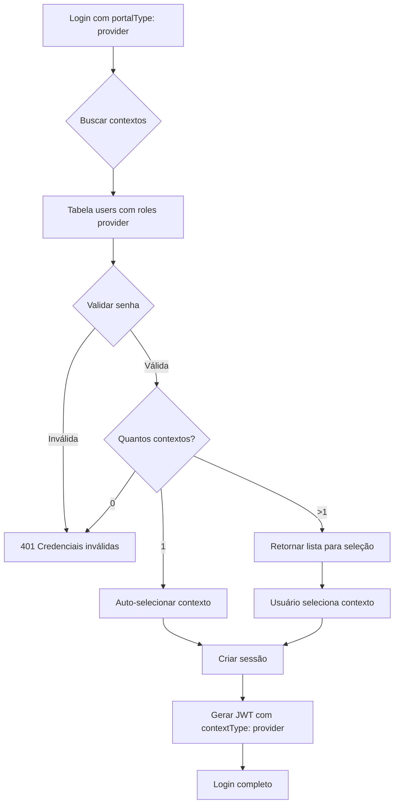

# Implementação: Login do Backoffice (Provider)

## 📋 Resumo

Implementado suporte completo para login de usuários do **backoffice** (provider) no sistema multi-contexto.

## ✅ Alterações Realizadas

### 1. **backend/src/services/contextService.js**

#### Imports Atualizados
```javascript
import User from '../modules/users/userModel.js';
```

#### Função `getContextsForEmail()` - Adicionada busca em tabela `users`
```javascript
// 1. Buscar contextos de PROVIDER (backoffice - tabela users)
const providerUsers = await User.scope('withPassword').findAll({
  where: { 
    email, 
    isActive: true,
    role: { 
      [Op.in]: ['super-admin', 'provider-admin', 'provider-support'] 
    }
  },
  include: [{
    model: Organization,
    as: 'organization',
    where: { isActive: true },
    required: true
  }]
});

// Validar senha e adicionar contextos de provider
for (const providerUser of providerUsers) {
  if (password) {
    const isValid = await providerUser.comparePassword(password);
    if (!isValid) continue;
  }

  contexts.push({
    id: providerUser.id,
    type: 'provider',
    userId: providerUser.id,
    userType: 'provider',
    contextId: providerUser.organizationId,
    contextType: 'provider',
    organizationId: providerUser.organizationId,
    organizationName: providerUser.organization?.name,
    organizationSlug: providerUser.organization?.slug,
    email: providerUser.email,
    name: providerUser.name,
    role: providerUser.role,
    permissions: providerUser.permissions,
    avatar: providerUser.avatar,
    isLastUsed: false,
    lastAccessedAt: null
  });
}
```

#### Função `validateContextAccess()` - Adicionado suporte a provider
```javascript
if (contextType === 'provider') {
  const providerUser = await User.findOne({
    where: {
      email,
      organizationId: contextId,
      isActive: true,
      role: { 
        [Op.in]: ['super-admin', 'provider-admin', 'provider-support'] 
      }
    },
    include: [{
      model: Organization,
      as: 'organization',
      where: { isActive: true },
      required: true
    }]
  });

  if (!providerUser) return null;

  return {
    userId: providerUser.id,
    userType: 'provider',
    contextId: providerUser.organizationId,
    contextType: 'provider',
    email: providerUser.email,
    name: providerUser.name,
    role: providerUser.role,
    permissions: providerUser.permissions,
    organizationId: providerUser.organizationId,
    organizationName: providerUser.organization?.name
  };
}
```

#### Função `getActiveContext()` - Adicionado suporte a provider
```javascript
if (session.contextType === 'provider') {
  const providerUser = await User.findOne({
    where: {
      id: session.userId,
      organizationId: session.contextId,
      isActive: true
    },
    include: [{
      model: Organization,
      as: 'organization',
      where: { isActive: true },
      required: true
    }]
  });

  if (providerUser) {
    contextData = {
      sessionId: session.id,
      userId: providerUser.id,
      userType: 'provider',
      contextId: providerUser.organizationId,
      contextType: 'provider',
      email: providerUser.email,
      name: providerUser.name,
      role: providerUser.role,
      permissions: providerUser.permissions,
      organizationId: providerUser.organizationId,
      organizationName: providerUser.organization?.name,
      avatar: providerUser.avatar
    };
  }
}
```

#### Funções `setPreferredContext()` e `getPreferredContext()` - Atualizadas
- Adicionado suporte para buscar e armazenar contexto preferido na tabela `users`
- Modelo selecionado dinamicamente: `User`, `OrganizationUser` ou `ClientUser`

### 2. **backend/src/modules/auth/authController.js**

#### Função `selectContext()` - Validação de contextType atualizada
```javascript
// Validar contextType
if (!['provider', 'organization', 'client'].includes(contextType)) {
  return res.status(400).json({
    error: 'Tipo de contexto inválido',
    details: 'contextType deve ser "provider", "organization" ou "client"'
  });
}

// Validar senha com modelo correto
const Model = contextType === 'provider' ? User
  : contextType === 'organization' ? OrganizationUser 
  : ClientUser;

const userRecord = await Model.scope('withPassword').findByPk(contextData.userId);
```

#### Função `switchContext()` - Validação de contextType atualizada
```javascript
// Validar contextType
if (!['provider', 'organization', 'client'].includes(contextType)) {
  return res.status(400).json({
    error: 'Tipo de contexto inválido',
    details: 'contextType deve ser "provider", "organization" ou "client"'
  });
}

// Atualizar último login no modelo apropriado
const Model = newContextData.userType === 'provider' ? User
  : newContextData.userType === 'organization' ? OrganizationUser 
  : ClientUser;

const userRecord = await Model.findByPk(newContextData.userId);
```

## 📊 Tabelas de Autenticação por Portal

| Portal | portalType | Tabela Usada | Status |
|--------|-----------|--------------|--------|
| **Backoffice** | `provider` | `users` | ✅ **IMPLEMENTADO** |
| **Portal Organização** | `organization` | `organization_users` | ✅ Funcionando |
| **Portal Cliente** | `client` | `client_users` | ✅ Funcionando |
| **Desktop Agent** | `organization` ou `client` | `organization_users` ou `client_users` | ✅ Funcionando |

## 🔐 Roles de Provider Suportados

Os seguintes roles da tabela `users` são considerados como provider:
- `super-admin`
- `provider-admin`
- `provider-support`

## 🧪 Como Testar

### 1. Login no Backoffice

```javascript
// Request
POST /api/auth/login
{
  "email": "admin@provider.com",
  "password": "senha123",
  "portalType": "provider"
}

// Response (contexto único)
{
  "message": "Login realizado com sucesso",
  "token": "jwt-token...",
  "user": {
    "id": "uuid",
    "email": "admin@provider.com",
    "name": "Admin Provider",
    "role": "super-admin",
    "userType": "provider",
    "permissions": [...]
  },
  "context": {
    "id": "org-uuid",
    "type": "provider",
    "organizationId": "org-uuid",
    "organizationName": "Provider Organization",
    "sessionId": "session-uuid"
  }
}
```

### 2. Múltiplos Contextos

Se o usuário tiver acesso a múltiplas organizações como provider:

```javascript
// Response
{
  "requiresContextSelection": true,
  "contexts": [
    {
      "id": "user-uuid-1",
      "type": "provider",
      "userType": "provider",
      "contextId": "org-uuid-1",
      "contextType": "provider",
      "organizationId": "org-uuid-1",
      "organizationName": "Organização A",
      "name": "Admin Provider",
      "email": "admin@provider.com",
      "role": "super-admin",
      "isLastUsed": true,
      "isPreferred": false
    },
    {
      "id": "user-uuid-2",
      "type": "provider",
      "userType": "provider",
      "contextId": "org-uuid-2",
      "contextType": "provider",
      "organizationId": "org-uuid-2",
      "organizationName": "Organização B",
      "name": "Admin Provider",
      "email": "admin@provider.com",
      "role": "provider-admin",
      "isLastUsed": false,
      "isPreferred": true
    }
  ]
}
```

### 3. Selecionar Contexto

```javascript
POST /api/auth/select-context
{
  "email": "admin@provider.com",
  "password": "senha123",
  "contextId": "org-uuid-1",
  "contextType": "provider"
}
```

### 4. Trocar Contexto Durante Sessão

```javascript
POST /api/auth/switch-context
Headers: { Authorization: "Bearer jwt-token" }
{
  "contextId": "org-uuid-2",
  "contextType": "provider"
}
```

## 🔄 Fluxo Completo de Login



## ✅ Validações Implementadas

1. ✅ Email e senha validados na tabela `users`
2. ✅ Apenas roles de provider são aceitos (`super-admin`, `provider-admin`, `provider-support`)
3. ✅ Usuário deve estar ativo (`isActive: true`)
4. ✅ Organização deve estar ativa (`isActive: true`)
5. ✅ Suporte a múltiplos contextos (mesmo email em múltiplas organizações)
6. ✅ Sessões de contexto criadas e gerenciadas
7. ✅ Audit logs de troca de contexto
8. ✅ Contexto preferido armazenado

## 📝 Notas Importantes

1. **Segurança**: Apenas usuários com roles específicos de provider podem fazer login no backoffice
2. **Multi-contexto**: Um usuário provider pode ter acesso a múltiplas organizações
3. **Compatibilidade**: O sistema continua funcionando normalmente para organization e client
4. **JWT**: O token inclui `userType: 'provider'` e `contextType: 'provider'`
5. **Permissões**: As permissões RBAC são carregadas automaticamente do usuário

## 🚀 Próximos Passos

1. Testar login no backoffice com usuários reais
2. Verificar se o frontend do backoffice está enviando `portalType: 'provider'`
3. Validar fluxo de múltiplos contextos se aplicável
4. Testar troca de contexto durante sessão ativa

---

**Data de Implementação**: 2026-04-09
**Status**: ✅ Completo e Pronto para Testes
